# GAIA Archtree

**Two adversarial binary trees of agents — one builds, one tears the build apart — rooted in a single persona with the deepest memory, so every worker below it can run on a clean context.**

Designed in 2025; it turned out to be a very good structure for multi-agent systems. This repo is the ignition skill plus the full design. The mechanism it rides on lives in [gaia-daemon](https://github.com/pascaldisse/gaia-daemon) (`summon` / `whales` / `resume` / `src/services/archtree.ts`).

- Full design → [DESIGN.md](DESIGN.md)
- Ignition skill (the operating canon the apex loads) → [skills/gaia-archtree-pi/SKILL.md](skills/gaia-archtree-pi/SKILL.md)

## Thesis

Single-agent loops fail in two ways: context rots as the task grows, and a model that grades its own work agrees with itself. Archtree answers both structurally rather than with prompting:

1. **Adversarial twin (陽 / 陰).** Every build tree has a mirror tree whose only job is to break the build's output: boot it, attack edge cases, check architecture, file reproducible tickets. Adversary lanes issue verdicts, never fixes.
2. **One deep memory at the apex.** Exactly one persona carries long-term memory and the user relationship. It plans, routes, and *verifies* — nothing below it is trusted until the apex has checked it itself.
3. **Clean-context children.** Each child is a fresh instance with an empty context window, handed a self-contained spec and speaking a compact notation (*gaiago*: fragments + arrows, no filler prose) to its parent and its own children. Depth is cheap because nothing is inherited except the spec.
4. **Seasonal rotation (季節の輪, "circle of seasons").** Roles and models rotate between waves, so no context ages into a rut and different personas/models produce different outputs on the same board.

## Diagram

```
                          APEX  (one persona, deepest memory)
                         /                              \
               陽 BUILD root                        陰 ADVERSARY root
               /          \                          /            \
          build child   build child            attack child    attack child
           /      \       /      \               /     \         /     \
         ...      ...   ...      ...           ...     ...     ...     ...

   depth ≤ 4 → up to 16 nodes per side (32 + 32 at full build)
   陽 output ──────────────► 陰 audits it ──► tickets with repro ──► 陽 fixes
   every wave: roles/models rotate (季節の輪) → contexts stay clean
```



```mermaid
flowchart TD
  A([APEX persona<br/>deepest memory · verifies]) --> Y[陽 BUILD root]
  A --> N[陰 ADVERSARY root]
  Y --> Y1[build child] & Y2[build child]
  N --> N1[attack child] & N2[attack child]
  Y1 --> Y11[...] & Y12[...]
  N1 --> N11[...] & N12[...]
  Y1 -. output .-> N1
  N1 -. tickets + repro .-> Y1
  A -. new orthogonal task → extra root branch .-> R[root branch]
  subgraph wave["each wave: 季節の輪 rotates roles & models"]
    Y
    N
  end
```

## How it maps onto the daemon

Archtree adds **no tree manager**. A tree is just ordinary summon lanes whose `parentRoomId` links form the tree.

| Archtree concept | gaia-daemon mechanism |
|---|---|
| Spawn a child | `summon` tool / `gaia summon` → `SummonCoordinator.launch(parentRoomId, agentId, task, opts)` (`src/services/summons.ts`). Returns the child room id immediately; never blocks the caller's turn. |
| Fan-out within a node | `summon` with a `whales: [{agent, task}, …]` list (`src/harness/tools-pi.ts`) — parallel workers, each in its own sub-room. A per-room cap on running children is enforced at launch. |
| Tree edges | `state.parentRoomId` is stamped on the child room before its first turn; the sidebar and the 3D view derive the tree from it. |
| Results flow upward | On completion the worker's result is posted into the parent room as a collapsed note authored by the worker; `deliver: "turn"` additionally re-invokes the calling agent (steer its running turn, else a fresh turn). Failures are delivered too. Delivery is stamped durably at launch and re-armed after a daemon restart (`recoverUndelivered`). |
| Steer a running node | `gaia resume <roomId> "<message>"` appends orders to a live (or settled) sub-room; tracked to delivery when it is a summon child. `gaia summon --status` gives a census (running / idle / completed-undelivered / dead). |
| Clean context | Each summon is a fresh room (incognito: transcripts stay out of recall/episodic memory), optionally in its own git worktree (`ownWorktree`). |
| Trust follows delegation | A summon launched by an untrusted caller runs under the untrusted (sandboxed) tier; a worker cannot escape its sandbox by summoning. |
| Add a root while the tree is live | `/archtree add-root [--agent <agent>] <task>` · `gaia archtree` · `POST /api/harness/archtree` → `addArchtreeRoot()`. |

### `src/services/archtree.ts`

The whole file is one function, `addArchtreeRoot(coordinator, request)`:

1. Validates a non-empty `task` and `agentId`.
2. Loads the installed `gaia-archtree` skill via `loadSkillText(workspace, ["gaia-archtree"])`; **fails loudly** (no launch) if the skill is missing or empty — a root never starts without the canon.
3. Builds the prompt: skill text + a `# Root branch` header (scope = assigned task only; preserve the existing tree; skill laws apply to every delegated child) + `# Task`.
4. Calls the ordinary `coordinator.summon(parentRoomId, agentId, prompt, { ownWorktree: true (default), deliver })` — `deliver: "turn"` + `callerAgentId` when an agent originated the root (result and callback go to it), `"note"` when a human did.

Because a root is an ordinary summon lane, it inherits the whole lifecycle for free: parent-link registration (so it appears in the room tree immediately), the per-room running cap, heartbeat/timeout handling, durable delivery, failure reporting, and `resume` steering. Roots then spawn their own children by calling `summon` themselves — the tree builds itself recursively, as the skill instructs.

## Implemented vs designed

| Piece | Status | Notes |
|---|---|---|
| Summon lanes: parent link, background run, upward delivery, durable re-arm, failure delivery | **Implemented** (daemon) | `src/services/summons.ts`; covered by `test/summons.test.ts` |
| `whales` parallel fan-out | **Implemented** (daemon) | `src/harness/tools-pi.ts` |
| `resume` steering + `summon --status` census | **Implemented** (daemon) | |
| Trust tier follows delegation | **Implemented** (daemon) | |
| `addArchtreeRoot` — live extra roots, skill injected, own worktree | **Implemented**, compiled-binary lifecycle proof with three live roots | `test/archtree-root.test.ts`; proof write-up in the daemon repo `docs/ARCHTREE-P1-PROOF.md` |
| Ignition skill (topology, routing, specs, adversary mandate) | **Implemented** (this repo) | prompt-level canon, not code |
| 3D room-tree view (`/archtree`): 陽 crown mirrored by a 陰 root half, status colors, click-to-open room | **Implemented** (WebGL2, no dependencies) | model/layout covered by headless tests; some optics (rune ring, crows, ground mist) still open |
| Binary shape, depth ≤ 4, 陽/陰 pairing, adversary-only-judges | **Designed; enforced by skill, not by daemon code** | the daemon does not currently reject a non-binary or deeper tree |
| 季節の輪 role/model rotation between waves | **Designed; operated manually by the apex per the skill** | no scheduler |
| Full 32 + 32 build in one run | **Designed**; trees of 3–12 roots and ~170 commits have been run | |
| Explicit `failed` outcome on the tree view | **Designed** | today inferred from activity age |
| Alternative (GWE) renderer behind the same port | **Designed** | interface only |
| Full recursive orchestration proof (routing, descendant compliance) end to end | **UNVERIFIED** as a controlled experiment | the lifecycle probe covered roots only |

## Requires

gaia-daemon >= `4da2981` for `/archtree` to be reachable at all.

## Install

```
pi install git:github.com/pascaldisse/gaia-archtree-pi
```

Then say the trigger phrase from the skill ("starte gaia archtree") to ignite a tree, or add a branch to a live one with `/archtree add-root <task>`.

## License

MIT © Pascal Disse
